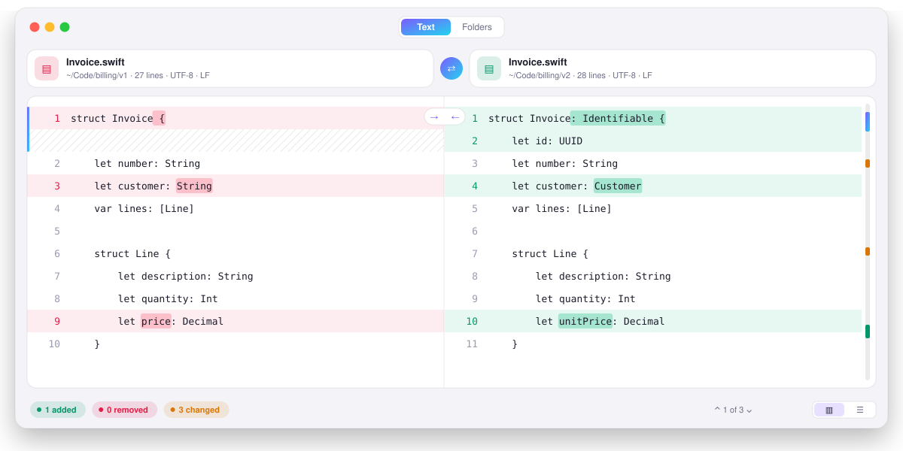

<div align="center">

<picture>
  <source media="(prefers-color-scheme: dark)" srcset="assets/banner-dark.svg">
  
</picture>

<br>

<a href="https://github.com/SherinBloemendaal/moire/actions/workflows/ci.yml"></a>
<a href="https://github.com/SherinBloemendaal/moire/releases/latest"></a>
<a href="LICENSE"></a>


**Moire** is a native macOS app for comparing text, files and folders, and for merging them.<br>
Repo: [github.com/SherinBloemendaal/moire](https://github.com/SherinBloemendaal/moire)

[Install](#-install) · [Text](#-comparing-text) · [Folders](#-comparing-folders) · [Merging](#-merging) · [Other files](#%EF%B8%8F-other-kinds-of-files) · [Speed](#-speed) · [Command line](#-command-line) · [Shortcuts](#%EF%B8%8F-shortcuts) · [Roadmap](#%EF%B8%8F-roadmap) · [Building](#-building)

</div>

<br>

<picture>
  <source media="(prefers-color-scheme: dark)" srcset="assets/preview-dark.svg">
  
</picture>

> *A moiré is the shimmering pattern you see when two almost identical grids lie on top of each other. It only shows up where they differ, and showing that is all Moire does.*

## ✨ Highlights

- **Text, side by side or unified**, with the changed words marked, syntax colors, find, and editing right in the comparison.
- **Folders with millions of files**, read on every core and shown while they are being compared, by metadata, by the first and last 64 KB, byte for byte, or line by line.
- **Folders on servers:** SFTP, FTP, FTPS and S3 (and S3-compatible storage such as Cloudflare R2, MinIO and Backblaze B2).
- **Three-way merge** with conflicts to take left, right or both, and a `git mergetool` that tells git when the merge is not done.
- **Folder sync:** update, mirror or both ways, always with a plan to look at first.
- **Other kinds of files:** hex, images (side by side, overlay, swipe, difference mask), tables and CSV, PDF and Word as text, zip and tar archives as folders.
- **Rules for what does not matter:** comments, patterns and blank lines, per kind of file.
- **Windows and tabs**, saved comparisons, printing, patches and HTML reports, and a `moire` command for scripts.
- **Light and dark**, following your Mac.

## 📦 Install

```bash
curl -fsSL https://sherin.dev/moire/install.sh | bash
```

Pin a release with `bash -s`:

```bash
curl -fsSL https://sherin.dev/moire/install.sh | bash -s v1.0.0
```

The script downloads `Moire.zip` from the GitHub release, checks it against `SHA256SUMS`, and installs `Moire.app` into `/Applications` (or `~/Applications` when `/Applications` is not writable; override with `MOIRE_INSTALL`). Run it again to upgrade in place. To uninstall, move `Moire.app` to the Trash.

### Download

Download [`Moire.dmg`](https://github.com/SherinBloemendaal/moire/releases/latest/download/Moire.dmg), open it, and drag Moire onto the Applications folder. It runs on Apple Silicon and Intel Macs with macOS 15 or later.

<details>
<summary><b>Other downloads and the first launch</b></summary>

<br>

Every [release](https://github.com/SherinBloemendaal/moire/releases/latest) also has `Moire.zip` (the app on its own) and `SHA256SUMS`, which covers both downloads.

> [!NOTE]
> Moire is not notarized by Apple, so macOS blocks it the first time when it was downloaded with a browser. Open it once, then go to **System Settings → Privacy & Security** and click **Open Anyway**. Or clear the download flag:
>
> ```bash
> xattr -dr com.apple.quarantine /Applications/Moire.app
> ```
>
> The install script does not need this: files downloaded with `curl` are not flagged.

</details>

## 📝 Comparing text

Drop two files on the window, open them with ⌘O, or paste two snippets.

- **Side by side or unified** (⌃⌘1, ⌃⌘2). Lines line up across both sides, a changed line sits next to its new version, and the words that changed are marked.
- **Jump between changes** with ⌥⌘↓ and ⌥⌘↑, or click a mark in the change map beside the scroll bar.
- **Copy a change across:** hover it and click → or ←, or use ⌥⌘→ and ⌥⌘← on the current change. Hover a single line of a change to copy just that line. Every copy can be undone.
- **Edit in place:** click a line and type. Return splits a line, Backspace at the start joins it with the line above, and the markings follow as you type. ⌘E opens a plain editor for both sides.
- **Find** (⌘F) searches both sides at once, with ⌘G and ⇧⌘G for the next and previous match. **Go to Line** is ⌘L.
- **Syntax colors** for Swift, JavaScript and TypeScript, JSON, Python, PHP, Go, Rust, C, C++ and Objective-C, Java and Kotlin, HTML and XML, CSS, YAML, Markdown, shell and SQL.
- **Only changes** (⌥⌘F) folds long runs of unchanged lines away, keeping three lines around each change.
- **Align lines by hand** when the automatic pairing is wrong: right-click a line on each side, mark them, and choose **Align Marked Lines**.
- **Reloads by itself** when a file changes on disk. A side with unsaved edits asks first.
- **Ignore what does not matter:** spaces at the line ends, all spaces, upper and lower case, and the rules in **Settings → Rules** (below).
- **Saves the way it found the file:** UTF-8, UTF-16 or Latin-1, with or without a byte order mark, and LF, CRLF or CR line endings.
- **Huge files** with millions of lines open in about two seconds.

### Rules for what does not matter

**Settings → Rules** (⌘,) holds rules for every file, or per extension such as `.swift` or `.log`:

- **Ignore comments**, in the comment syntax of the language: `//` and `/* */`, `#`, `--`, `<!-- -->` and more. Comment markers inside strings are left alone.
- **Ignore text matching** regular expressions, such as a timestamp or a build number.
- **Ignore blank lines.**

A change made only of such lines is drawn in grey, is not counted, and is skipped by Next Change. The folder comparison uses the same rules when it compares line by line.

## 📁 Comparing folders

Switch to **Folders** in the toolbar (⇧⌘O) and choose or drop two folders. Results fill in while Moire works, with the speed and the time left, and **Stop** keeps what was found so far.

Choose how files are compared:

| Method | What is read | For |
| --- | --- | --- |
| **Metadata** | Nothing: size and date only. A date may be 2 seconds off (FAT disks) or one hour (daylight saving). | Network disks, slow USB drives, a quick look |
| **Quick** | The first and last 64 KB of files of the same size | Large trees where a full read takes too long |
| **Binary** | Every byte | Being sure |
| **Lines** | The text, with the ignore options and rules | Source code; the list shows how many lines changed |

- **Network disks start on Metadata.** Moire sees when a folder is on a network volume and says so on its card.
- **A second look is close to instant.** Results are remembered per file pair (by file ID, size and date), so comparing the same folders again only reads what changed since.
- **Filters:** only files matching masks such as `*.swift`, leave out `node_modules/` or `*.log`, follow `.gitignore` files (nested ones too), and include hidden files or not.
- **Act on items:** double-click a file to compare it; right-click to rename, move to the Trash, or show in Finder on either side.
- **Sync** (the ⟳ button, or right-click): **Update** copies what is missing and replaces older files, **Mirror** makes the target an exact copy and moves extra items to the Trash, and **Both Ways** lets the newer file win on each side. You always see the plan first. Copies keep their dates and permissions, are clones on APFS, and arrive through a temporary file, so an interrupted copy never leaves half a file.
- **Folders on servers:** the server button on a card connects to `sftp://`, `ftp://`, `ftps://` or `s3://`. SFTP uses your `ssh` setup (keys, agent, `~/.ssh/config`), FTP passwords live in the Keychain, and S3 reads your `~/.aws` profiles. A file on a server opens in the text comparison as a read-only copy. Tested end to end: S3 against a RustFS server, SFTP through `ssh` against a real `sshd`, and FTP, FTPS and FTPES through `curl` with real TLS (an untrusted certificate is refused). `scripts/test-live-servers.sh` runs the S3 and SFTP checks again; Amazon's own S3 has not been tried.
- **Reports:** File → Export Folder Report saves the comparison as HTML, JSON or text.

## 🔀 Merging

Switch to **Merge**, or choose File → Merge Files… (⌥⌘O), and pick the left, base and right files. Changes made on one side are taken over by themselves; for each conflict, take the left, the right, both in either order, or edit the result by hand. Saving with conflicts left writes the usual conflict markers.

To use Moire with git:

```bash
git config --global merge.tool moire
git config --global mergetool.moire.cmd '/Applications/Moire.app/Contents/MacOS/Moire --merge "$BASE" "$LOCAL" "$REMOTE" "$MERGED"'
git config --global mergetool.moire.trustExitCode true
git config --global diff.tool moire
git config --global difftool.moire.cmd '/Applications/Moire.app/Contents/MacOS/Moire "$LOCAL" "$REMOTE"'
```

Quitting without saving tells git the merge is not done yet.

A comparison of two text files can also be exported: File → **Export as Patch…** writes a unified diff that `patch` and `git apply` accept, and **Export as HTML Report…** writes a page to share.

## 🖼️ Other kinds of files

Moire picks a view from the kind of file, and **View As** in the toolbar switches by hand.

- **Hex:** offsets, bytes and text for both sides, with changed bytes marked. Files of any size scroll smoothly, because only the visible pages are read. **Find Insertions** lines up the rest of a file after inserted bytes.
- **Images:** side by side, as an overlay with an opacity slider, with a swipe, or as a difference mask with a tolerance. Moire also says when two different files decode to identical pixels.
- **Tables and CSV:** cell by cell, with rows matched by key columns you choose.
- **PDF and Word** (`.docx`, `.doc`, `.rtf`, `.odt`): compared as text, read-only.
- **Archives** (zip, tar, tar.gz, tar.bz2, tar.xz): opened as folders. Entries that would land outside their folder are refused, and so is an archive that would not fit on the disk once unpacked.

## ⚡ Speed

Moire was built to compare millions of files. Measured on an M2 Max (12 cores, 64 GB, APFS), with a warm file cache, by `moire-bench`:

| Files | Metadata | Quick | Binary | Lines | Binary, second time |
| --- | --- | --- | --- | --- | --- |
| 100,000 | 0.3 s | 2.5 s | 2.4 s | 2.5 s | 0.3 s |
| 1,000,000 | 5.8 s | 65 s | 65 s | 66 s | 5.7 s |

The 1.0 engine needed 17.5 s for 10,000 files and grew with the square of the count. How the new one gets there:

- Folders are listed with `getattrlistbulk`, a few system calls per folder instead of several per file.
- Folders are listed and files are read at the same time, by two pools of threads. On APFS, opening files that macOS still holds in memory stops scaling at about four threads, so local disks start with half the performance cores; network shares use eight, because there the waiting is for the network.
- A tree too big for macOS's file cache (more than about 130,000 items per side) is read from the SSD instead, and there many requests at once pay off: the pools then grow to 16 and 32 threads. That took 1,000,000 files from 145 s to 65 s.
- Every method stops at the first check that settles it: a different size needs no reads at all.
- The tree is stored as flat arrays, about 62 bytes per item: ten million items take about 600 MB.
- The list only draws the rows on screen.
- Text files are read into one block of memory and their lines are hashed on all cores, so 5 million lines take about 2 s to open.

## 💻 Command line

The app contains a `moire` command for scripts. Link it into your `PATH`:

```bash
ln -sf /Applications/Moire.app/Contents/Helpers/moire /usr/local/bin/moire
```

```bash
moire compare old/ new/ --method quick --exclude "node_modules/,*.log" --differences
moire compare old/ new/ --format json --output report.json
moire compare a.txt b.txt                  # a unified diff, like diff -u
moire sync source/ backup/ --mode mirror --dry-run
```

It exits like `diff`: 0 when the sides are the same, 1 when they differ, 2 on trouble. `moire compare --help` lists every option.

To open two files or folders in the app from a terminal, run the app's binary with them: `/Applications/Moire.app/Contents/MacOS/Moire old.txt new.txt`.

## ⌨️ Shortcuts

| Action | Shortcut |
| --- | --- |
| New window / new tab | ⌘N / ⌘T |
| Open files / compare folders / merge files | ⌘O / ⇧⌘O / ⌥⌘O |
| Save / reload from disk | ⌘S / ⌘R |
| Save the comparison to open later | ⇧⌘S |
| Print | ⌘P |
| Find / next / previous | ⌘F / ⌘G / ⇧⌘G |
| Go to line | ⌘L |
| Next / previous change | ⌥⌘↓ / ⌥⌘↑ |
| Copy the change to the right / left | ⌥⌘→ / ⌥⌘← |
| Plain editor | ⌘E |
| Swap the sides | ⇧⌘X |
| Side by side / unified | ⌃⌘1 / ⌃⌘2 |
| Only show changes | ⌥⌘F |
| Bigger / smaller / actual text | ⌘+ / ⌘− / ⌘0 |
| Next / previous conflict | ⌃⌘↓ / ⌃⌘↑ |
| Take left / right | ⌃⌘← / ⌃⌘→ |
| Take both, left first / right first | ⌃⌘B / ⌃⌥⌘B |
| Edit a conflict by hand / undo the choice | ⌃⌘E / ⌃⌘⌫ |
| Settings (rules) | ⌘, |

## 🗺️ Roadmap

Everything below is done. Ideas for what comes next are welcome as issues.

<details>
<summary><b>Phase 0 to 5, all done</b></summary>

<br>

**Phase 0: speed.** ✅ Folders read on every core · ✅ Metadata, Quick, Binary and Lines · ✅ Metadata only on network disks · ✅ Cheapest check first · ✅ I/O tuned to the disk · ✅ Result cache · ✅ Results while working, with progress and Stop · ✅ Compact memory · ✅ A list that scales · ✅ Huge text files · ✅ Benchmarks in CI

**Phase 1: daily use.** ✅ Find and Go to Line · ✅ Syntax colors · ✅ Edit in the comparison · ✅ Reload on change · ✅ Folder filters and `.gitignore`

**Phase 2: merging.** ✅ Three-way merge and `git mergetool` · ✅ Single lines from a change · ✅ Patch and HTML export

**Phase 3: folder sync.** ✅ Update, mirror and both ways, with a plan first · ✅ Compare by date and size · ✅ Trash, rename and copy from the list

**Phase 4: other kinds of files.** ✅ Hex · ✅ Images · ✅ Tables and CSV · ✅ Archives · ✅ PDF and Word

**Phase 5: workflow.** ✅ Saved and recent comparisons · ✅ Windows and tabs · ✅ Rules for what does not matter · ✅ Align lines by hand · ✅ SFTP, FTP and S3 · ✅ Command line and printing

</details>

## 🔨 Building

Requires macOS 15 or later and Xcode 26 (Swift 6.2 or later). There are no dependencies.

```bash
./build-app.sh               # build/Moire.app for this Mac, with the moire command inside
UNIVERSAL=1 ./build-app.sh   # Apple Silicon and Intel in one app
scripts/make-dmg.sh          # build/Moire.dmg from build/Moire.app
swift test                   # run the tests
swift build -c release --product moire-bench && .build/release/moire-bench run --files 100000
```

Releases are built by GitHub Actions: push a tag like `v1.2.0` and the [Release workflow](.github/workflows/release.yml) tests, builds a universal `Moire.app`, and publishes `Moire.dmg` and `Moire.zip` with `SHA256SUMS`. The CI workflow also runs the benchmark on every push; see [benchmarks/](benchmarks/README.md).

<details>
<summary><b>Project layout</b></summary>

<br>

| Path | What it holds |
| --- | --- |
| `Sources/MoireKit` | Everything that is not on screen: the line, word and byte diffs, the three-way merge, the folder engine and its sources (local, SFTP, FTP, S3), sync, filters, rules, archives, tables, images and reports. No AppKit. |
| `Sources/Moire` | The SwiftUI and AppKit app. |
| `Sources/MoireCLI` | The `moire` command. |
| `Sources/MoireBench` | `moire-bench`, which builds fixed folder pairs and times the folder engine. |
| `Tests/MoireKitTests`, `Tests/MoireTests` | The tests. |
| `benchmarks/` | Measured results. |
| `install.sh` | The install script. |
| `art/`, `assets/` | The app icon and DMG background, and the pictures in this README, as SVG. |
| `scripts/` | `make-art.sh` (icon and DMG background) and `make-dmg.sh`. |

</details>

## 📄 License

MIT. See [LICENSE](LICENSE).
